# ha-scene-card

[](https://www.home-assistant.io/integrations/marketplace/)
[](https://github.com/juju35/ha-scene-card/actions/workflows/hacs.yml)
[](https://github.com/juju35/ha-scene-card/actions/workflows/validate.yml)
[](https://github.com/juju35/ha-scene-card/actions/workflows/lint.yml)
[](https://github.com/juju35/ha-scene-card/releases/latest)
[](https://github.com/juju35/ha-scene-card/blob/main/LICENSE)
[](https://buymeacoffee.com/julienstep9)

<p align="center"></p>

<p align="center">
  &nbsp;&nbsp;
  &nbsp;&nbsp;
  &nbsp;&nbsp;
  &nbsp;&nbsp;
  &nbsp;&nbsp;
  &nbsp;&nbsp;
  &nbsp;&nbsp;
  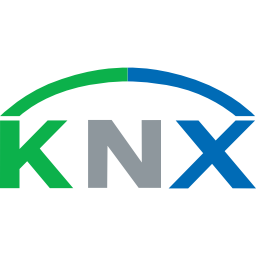
</p>

Lovelace cards for Home Assistant to **launch scenes and scripts**: a grid of **scenes** (of Home Assistant, Philips Hue, deCONZ, LIFX, SmartThings, Tuya, Overkiz, KNX… any scene) with the **active one highlighted** and when each was last activated, **scripts** with their **running state**, last run and a **stop** button, and a **filter by area**.

Every scene and script of Home Assistant is shown when nothing is configured (except those hidden in Home Assistant); pick the ones you want, in your order, or keep those of one or several areas: the card then follows what is added to them.

[](https://my.home-assistant.io/redirect/marketplace_repository/?owner=juju35&repository=ha-scene-card&category=plugin)

| Scene Card | Scene Mini Card |
|---|---|
| 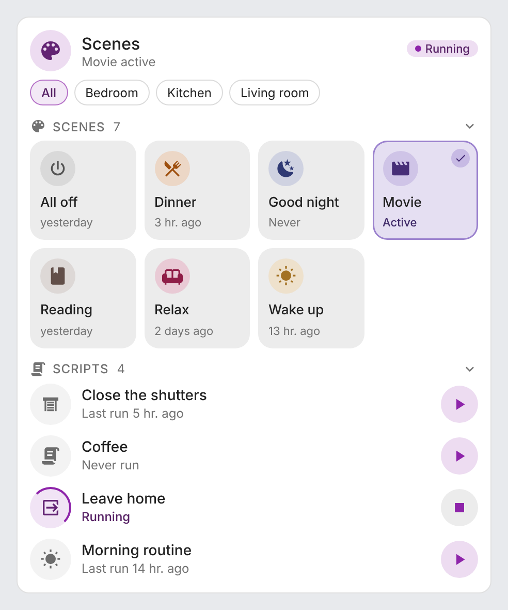 | 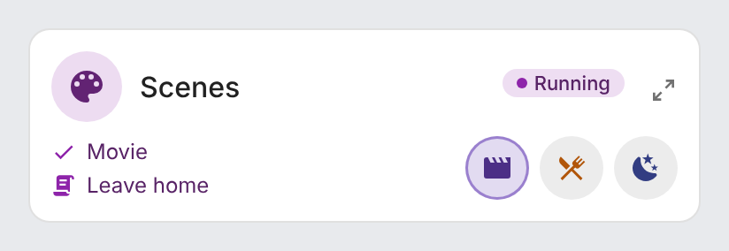 |

## Features

- Two cards: a full **Scene Card** (`custom:scene-card`) and a compact **Scene Mini Card** (`custom:scene-mini-card`)
- **Scenes** in a grid of tiles: a tap launches the scene, with a ripple from its icon (see [Animations](#animations))
- The **active scene** highlighted, with a tick: the last scene activated on its lights while none of them changed since (a Hue smart scene says it itself)
- When each scene was **last activated** (*3 hr. ago*, *yesterday*, *Never*)
- **Scripts** with their state: *Running* (an arc turns round the icon) with a **stop** button, else the last run and a **run** button
- **Area filter**: chips with the areas of the scenes and scripts shown, to keep one area
- Icons from Home Assistant or the card, else from the name (a film for *Movie*, cutlery for *Dinner*, a moon for *Good night*…) in a color of their own
- Header icon in a tinted round badge, the active scene in the subtitle and a status chip on the title's line when a script runs
- Collapsible sections, folded back to their default by a click elsewhere on the page
- Detail button on the mini card (top right): it switches the mini card to the full card's content and back; a click anywhere outside the card brings the compact view back
- Visual editor in the dashboard UI for both cards (no YAML needed)
- Light and dark mode, English, French, German, Spanish, Serbian (Cyrillic and Latin), Italian, Dutch, European Portuguese, Polish, Romanian, Danish, Swedish, Bulgarian, Russian, Ukrainian, Hungarian, Slovak, Czech, Slovenian, Latvian and Greek
- Single file, no external dependency

## Supported integrations

| Integration | What the cards use |
|---|---|
|  [Scenes](https://www.home-assistant.io/integrations/scene/) and [Scripts](https://www.home-assistant.io/integrations/script/) of Home Assistant (core) | Scenes with the lights they set (active scene detection), scripts with their running state, last run and stop |
|  [Philips Hue](https://www.home-assistant.io/integrations/hue/) (core) | Scenes of each room or zone (the room's lights for the active scene), smart scenes with their own active state |
|  [deCONZ](https://www.home-assistant.io/integrations/deconz/) (core) | Scenes of the groups |
|  [LIFX](https://www.home-assistant.io/integrations/lifx/) (core) | Scenes of the LIFX app |
|  [SmartThings](https://www.home-assistant.io/integrations/smartthings/) (core) | Scenes of the SmartThings app |
|  [Tuya](https://www.home-assistant.io/integrations/tuya/) (core) | Tap-to-run scenes of the Smart Life app |
|  [Overkiz](https://www.home-assistant.io/integrations/overkiz/) (core) | Scenarios of TaHoma, Connexoon… |
|  [KNX](https://www.home-assistant.io/integrations/knx/) (core) | KNX scenes |
| Any other integration with scenes | Its `scene.*` entities: launched with a tap, with when they were last activated |

The cards use Home Assistant's scene and script entities and services (`scene.turn_on`, `script.turn_on`, `script.turn_off`), so they work with any integration that provides scenes.

## Prerequisites

Home Assistant 2024.8 or later, with at least one scene or script.

## Installation

### Via the Marketplace (recommended)

Click the button below to add the repository directly:

[](https://my.home-assistant.io/redirect/marketplace_repository/?owner=juju35&repository=ha-scene-card&category=plugin)

Then click **Install**, and reload your browser when the Marketplace asks you to.

Or manually:

1. Open **Settings → Marketplace → Add from link** (top right; this needs a GitHub account connected)
2. Add `https://github.com/juju35/ha-scene-card` — Type: **Dashboard**
3. Open **Scene Card** and click **Install**
4. Clear your browser cache and refresh

The Marketplace adds the resource `/local/community/ha-scene-card/scene-card.js` for you.

### Manual

1. Download `scene-card.js` and the `scene-card.i18n.*.js` translation files from the [latest release](https://github.com/juju35/ha-scene-card/releases/latest)
2. Copy them all to `/config/www/` (without the translation files, the cards show in English)
3. Go to **Settings → Dashboards → ⋮ → Resources** → Add resource:
   - URL: `/local/scene-card.js`
   - Type: **JavaScript Module**
4. Clear your browser cache and refresh

## Configuration

### Card types

| Card | Type |
|---|---|
| Scene Card | `custom:scene-card` |
| Scene Mini Card | `custom:scene-mini-card` |

### Visual editor

Edit a dashboard, click **Add card** and search for **Scene Card** or **Scene Mini Card**. Every scene and script is shown when the lists are left empty; pick the scenes and scripts, the areas, the sections and the language. The preview updates live, and options left at their default are kept out of the generated YAML.

### Minimal

```yaml
type: custom:scene-card
```

```yaml
type: custom:scene-mini-card
```

### Full options

```yaml
type: custom:scene-card
title: Scenes
scenes:
  - scene.movie
  - entity: scene.dinner
    name: Dinner
    icon: mdi:silverware-fork-knife
    color: "#ef6c00"
scripts:
  - script.leave_home
area:
  - living_room
show_title: true
show_subtitle: true
show_scenes: true
show_scripts: true
show_area_filter: true
show_last: true
collapsed: []
language: en
```

```yaml
type: custom:scene-mini-card
scenes:
  - scene.movie
  - scene.dinner
  - scene.good_night
mini_count: 3
zoom: true
```

### Options reference

| Option | Card | Default | Description |
|---|---|---|---|
| `title` | both | Scenes | Card title |
| `show_title` | both | `true` | Show the title in the header |
| `show_subtitle` | full | `true` | Show the subtitle (the active scene) |
| `scenes` | both | Every scene | Scenes: entity ids, or objects with `entity`, `name`, `icon` and `color` |
| `scripts` | both | Every script | Scripts: entity ids, or objects with `entity`, `name` and `icon` |
| `area` | both | All | Area or areas: only their scenes and scripts |
| `show_scenes` | full | `true` | Scenes section |
| `show_scripts` | full | `true` | Scripts section |
| `show_area_filter` | full | `true` | Area chips (with two areas at least) |
| `show_last` | full | `true` | When each scene was last activated and each script last run |
| `mini_count` | mini | `3` | How many scenes the mini card shows as buttons (0 to 6) |
| `collapsed` | both | `[]` | Sections folded by default: `scenes`, `scripts`. Click a section title (or Tab to it and press Enter or Space) to fold or unfold it |
| `zoom` | mini | `true` | Detail button at the top right of the mini card: it shows the full card's content (with the same options, which can be set on the mini card too, in its visual editor as well) and switches back to the compact view; a click outside the card also brings the compact view back. `false` removes the button |
| `language` | both | Auto | Force language: `fr`, `en`, `de`, `es`, `sr`, `sr-Latn`, `it`, `nl`, `pt`, `pl`, `ro`, `da`, `sv`, `bg`, `ru`, `uk`, `hu`, `sk`, `cs`, `sl`, `lv` or `el` (auto-detects from HA settings) |

`scenes` and `scripts` as objects are YAML only; the visual editor edits them as lists of entities.

## Screenshots

### Animations

A scene launched: a ripple from its icon. A script running: an arc turns round its icon. Both honour `prefers-reduced-motion`:

| Light | Dark |
|---|---|
| 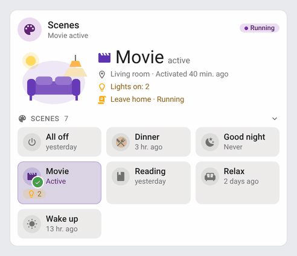 | 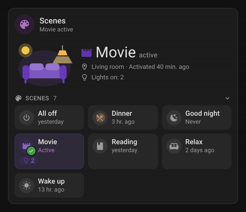 |

| Light | Dark |
|---|---|
| 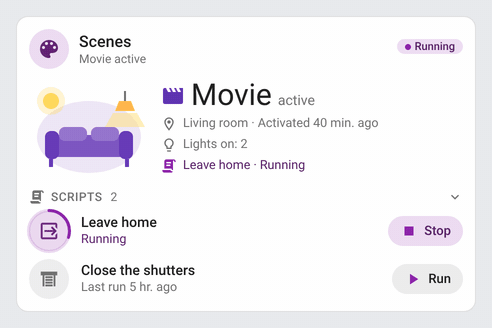 | 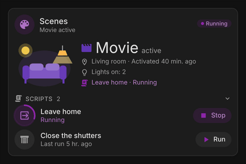 |

### Full card

Every scene and script, the movie scene active and a script running:

| Light | Dark |
|---|---|
|  | 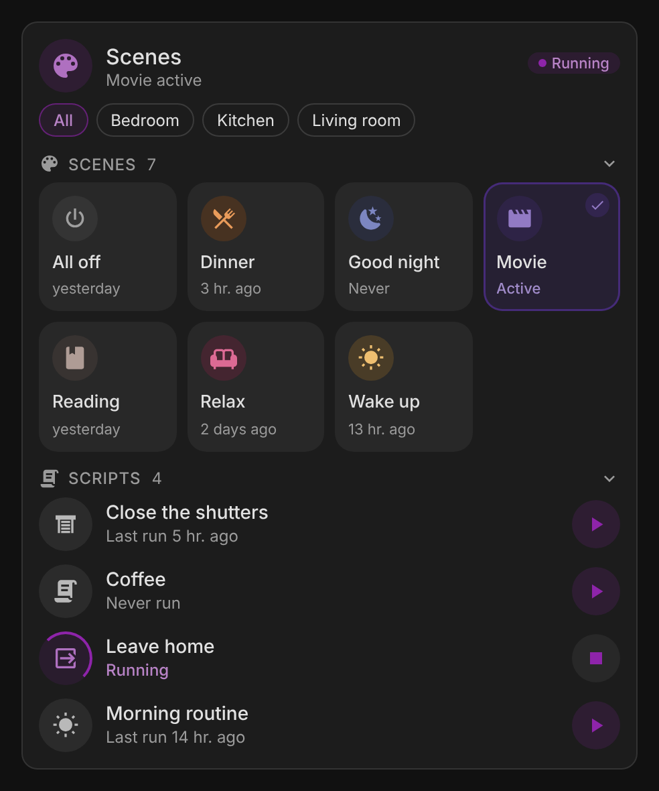 |

The living room only, from the area chips:

| Light | Dark |
|---|---|
| 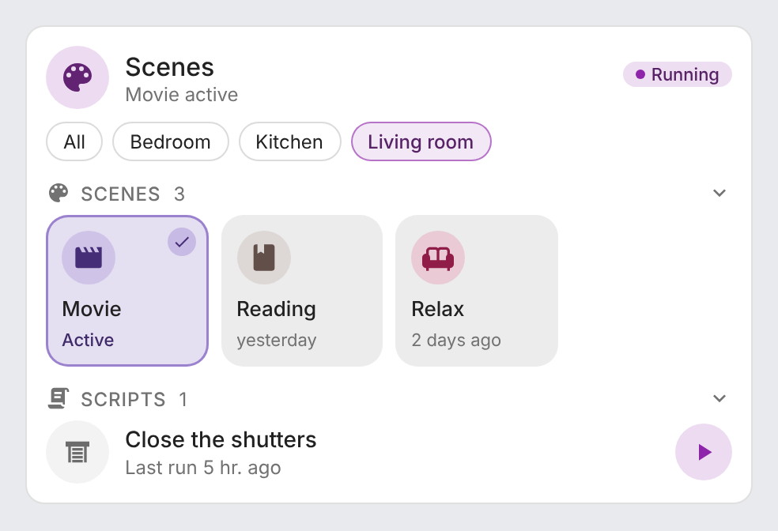 | 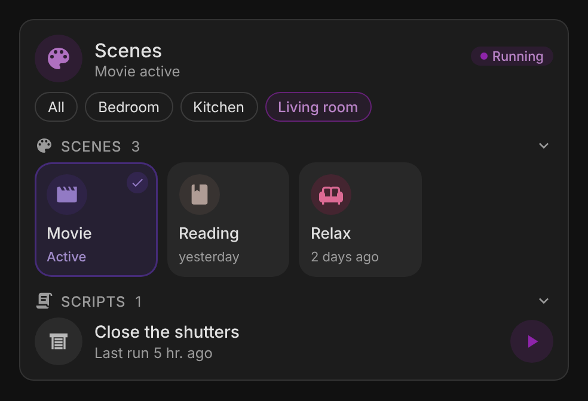 |

No scene active: a light changed since the last one:

| Light | Dark |
|---|---|
| 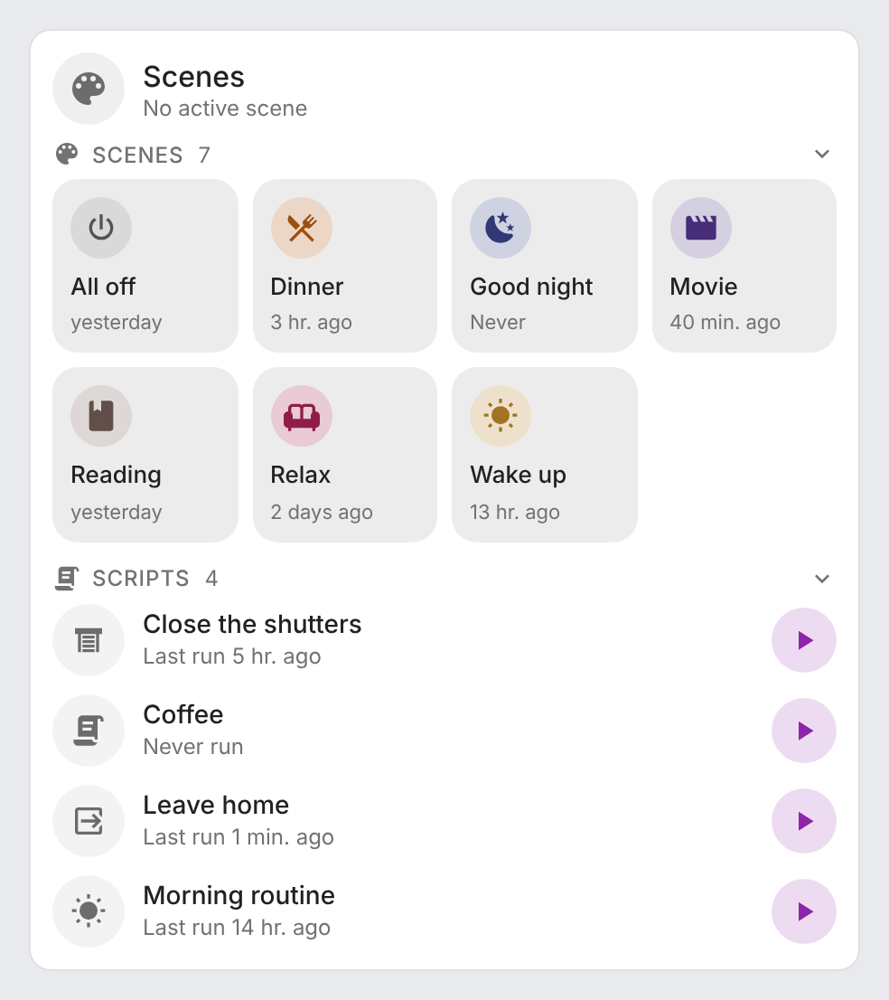 | 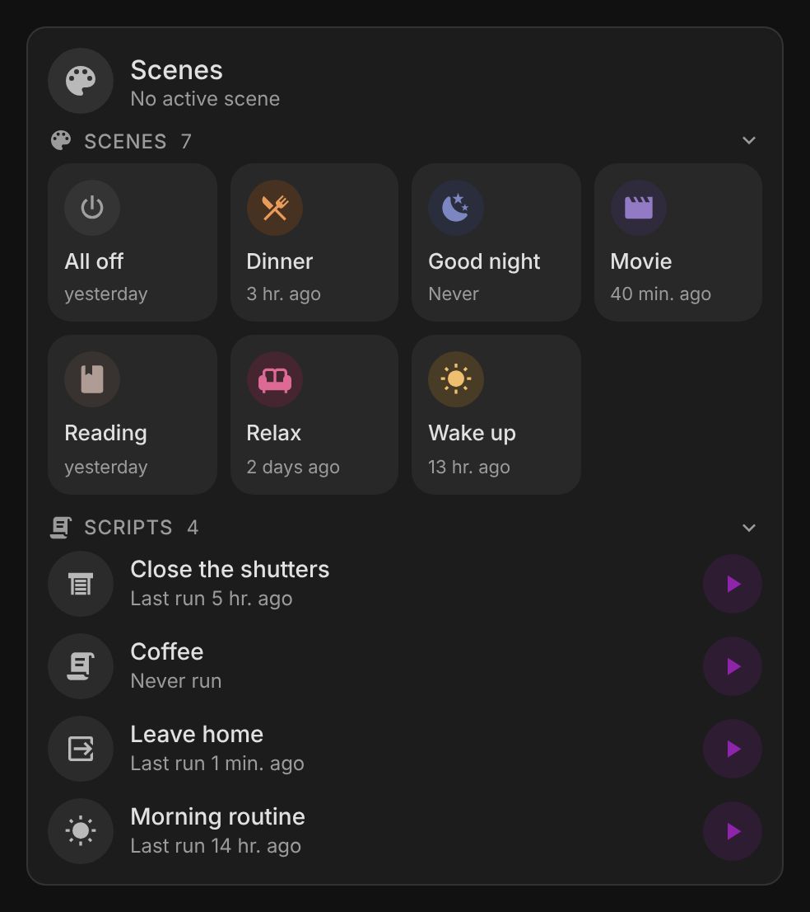 |

### Mini card

| Light | Dark |
|---|---|
|  | 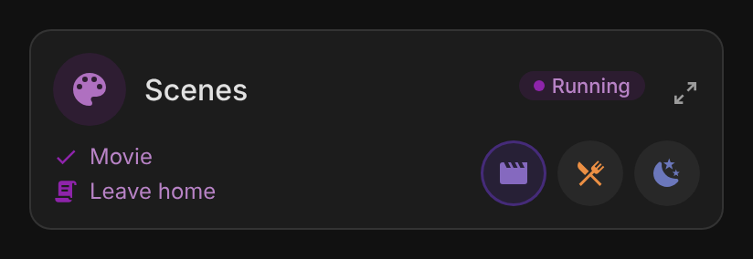 |

The detail button (top right) shows the full card's content:

| Light | Dark |
|---|---|
|  | 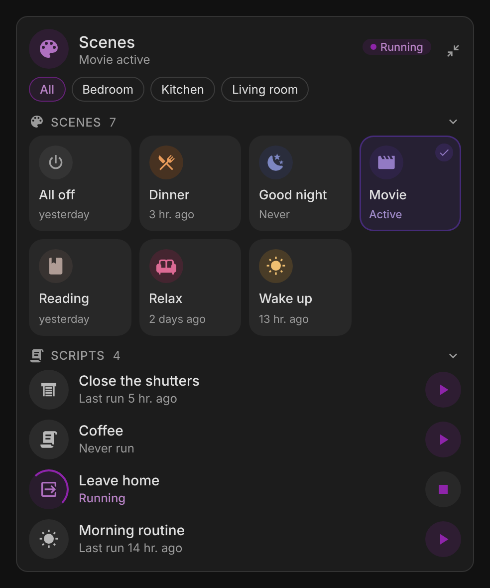 |

### Narrow cards

The full card at 6 columns of a phone's Sections view and the mini card at its minimum width:

| Light | Dark |
|---|---|
| 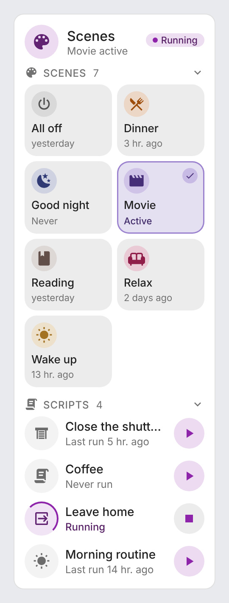 | 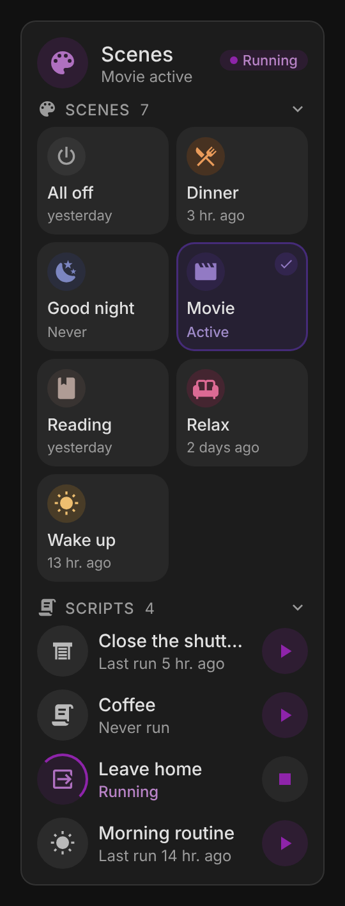 |
| 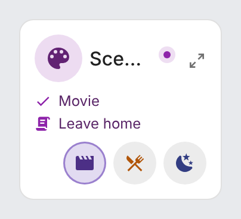 | 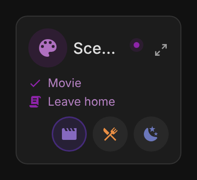 |

## How it works

- **Scenes** are the `scene.*` entities: their state is when they were last activated.
- **Active scene**: the lights a scene sets are its `entity_id` attribute (scenes of Home Assistant), else the lights of its area (Hue scenes belong to their room). The scene is active when it is the last activated on these lights and none of them changed since (10 seconds are left for the transitions). Hue smart scenes give their own `is_active`.
- **Scripts** are the `script.*` entities: `on` while they run, with `current` runs and `last_triggered`.
- **Areas** come from the entity registry, else from the device's area.

## Development

```bash
npm install
npm run build        # bundles src/scene-card.js into dist/scene-card.js (and its translation files)
npm run check        # builds and checks the card (run in CI)
npm test             # unit tests
npm run screenshots  # renders the cards (and one GIF per animated state, needs ffmpeg) with mock data into screenshots/
```

`dist/` is not committed: `npm run build` creates it locally, CI builds it on every push, and the release workflow attaches the built files to the release, which is where the Marketplace installs it from. The captures are rendered on a fixed clock with mock data (scripts/mock-states.mjs) and rewritten only when their pixels change, exactly; on a pull request, the **Screenshots** workflow commits them to the pull request's branch.

### Releasing

1. Bump `version` in `package.json` (and `package-lock.json`, with `npm install`)
2. Add a `## <version>` section at the top of [CHANGELOG.md](https://github.com/juju35/ha-scene-card/blob/main/CHANGELOG.md)
3. Push to `main`: the **Release** workflow builds the card, creates the tag and the GitHub release with the changelog section as notes, and attaches `scene-card.js` and its translation files

## Translations

The cards auto-detect the language from your Home Assistant settings. Currently supported:

| Language | Code |
|---|---|
| English | `en` |
| Français | `fr` |
| Deutsch | `de` |
| Español | `es` |
| Српски | `sr` |
| Srpski (latinica) | `sr-Latn` |
| Italiano | `it` |
| Nederlands | `nl` |
| Português (European; also used for `pt-BR`) | `pt` |
| Polski | `pl` |
| Română | `ro` |
| Dansk | `da` |
| Svenska | `sv` |
| Български | `bg` |
| Русский | `ru` |
| Українська | `uk` |
| Magyar | `hu` |
| Slovenčina | `sk` |
| Čeština | `cs` |
| Slovenščina | `sl` |
| Latviešu | `lv` |
| Ελληνικά | `el` |

English is in the card's file; every other language is in its own small file (`scene-card.i18n.<lang>.js`), loaded only when needed. Contributions for additional languages are welcome!

## Credits

Philips Hue, deCONZ, LIFX, SmartThings, Tuya, Overkiz and KNX are trademarks of their respective owners. This project is not affiliated with any of them. Icons from [Material Design Icons](https://pictogrammers.com/library/mdi/).

## License

[MIT](https://github.com/juju35/ha-scene-card/blob/main/LICENSE)

## Support

If you find this project useful, you can support its development:

<a href="https://buymeacoffee.com/julienstep9"></a>
